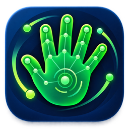
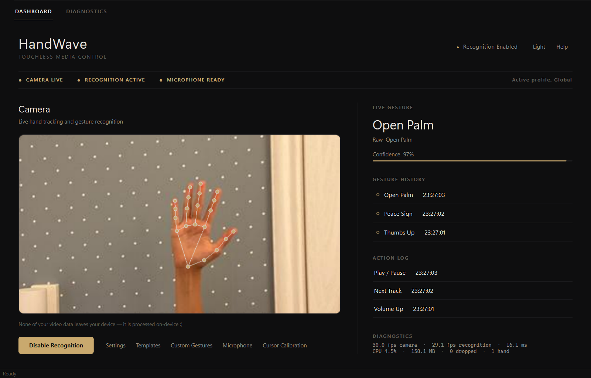
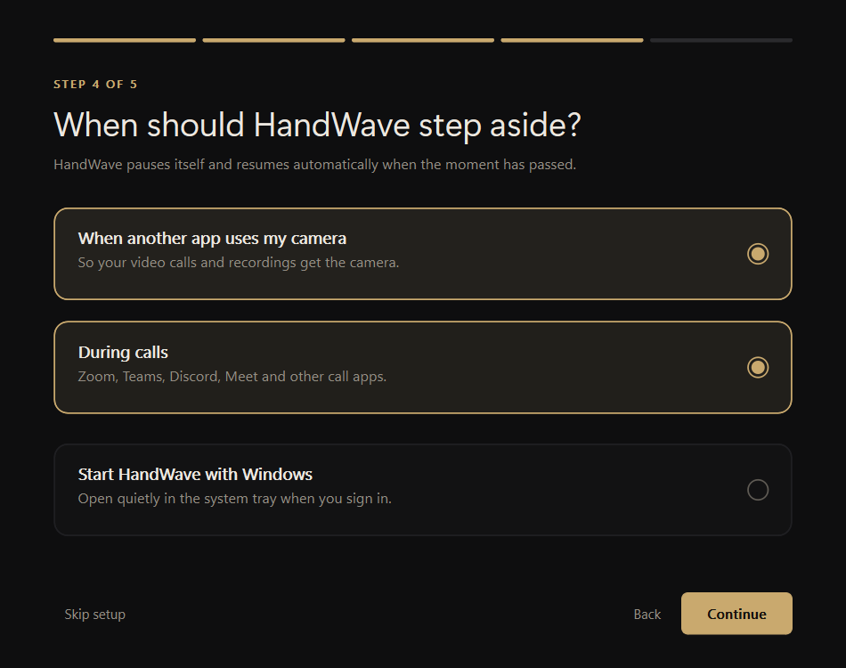
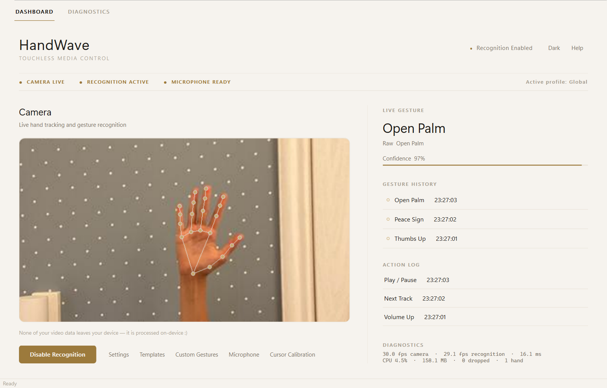
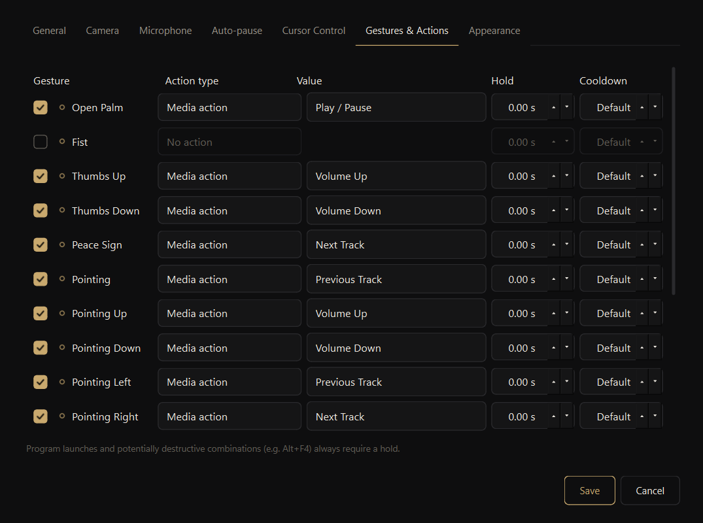
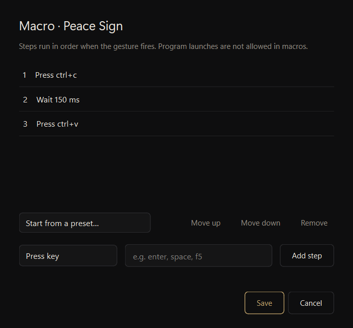
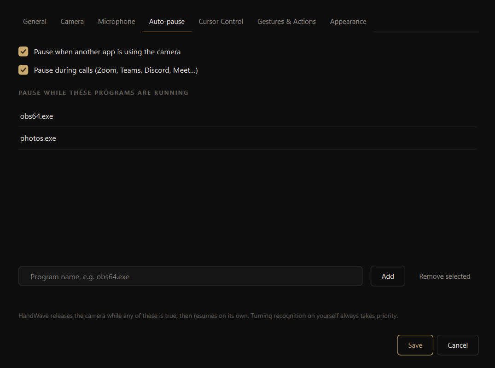
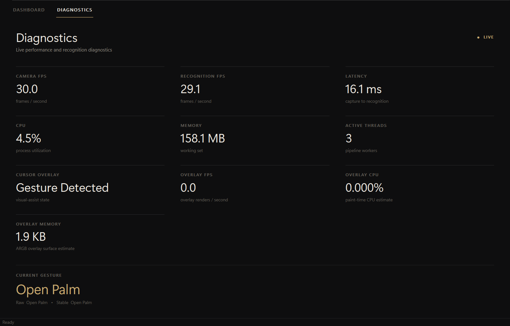
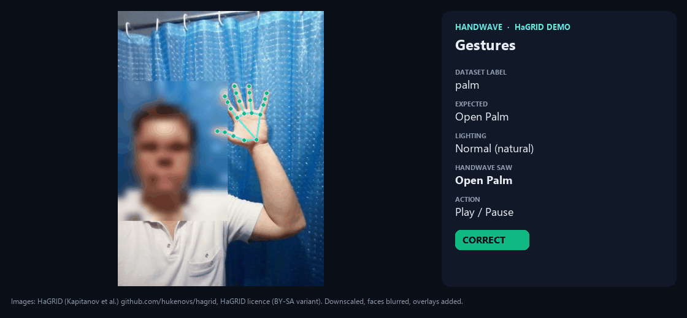

<p align="center">
  <a href="https://github.com/IshitaBhatt486/HandWave/releases/latest/download/HandWave.exe">
    
  </a><br>
  <sub>Logo: designed by Ishita Bhatt for HandWave (<code>handwave/assets/handwave.png</code>), MIT.</sub>
</p>

<h1 align="center">HandWave</h1>

<p align="center">
  Control your computer with hand gestures and a webcam. Everything runs on your machine.<br>
  <a href="https://github.com/IshitaBhatt486/HandWave/releases/latest/download/HandWave.exe"><b>Download for Windows</b></a>
  · <a href="#install-from-the-terminal">Install from the terminal</a>
  · <a href="docs/USER_GUIDE.md">User guide</a>
  · <a href="CHANGELOG.md">Changelog</a>
</p>


<sub>Source: screenshot of HandWave 1.1.0. Hand photo from [HaGRID](https://github.com/hukenovs/hagrid) (Kapitanov et al.), [HaGRID licence](https://github.com/hukenovs/hagrid/blob/master/license/en_us.pdf), cropped, run through HandWave's recogniser; not MIT-licensed. See [NOTICE](docs/demo/NOTICE.md).</sub>

HandWave watches your webcam for hand poses, swipes, pinches and two-hand
gestures, and turns each one into an action you choose: a media key, a
shortcut, a mouse click, typed text, a macro or a program launch. No video
leaves your computer, and there's no account, network access or telemetry.

## Download

| Version | Windows | macOS | Notes |
|---|---|---|---|
| 1.1.0 | [HandWave.exe](https://github.com/IshitaBhatt486/HandWave/releases/download/v1.1.0/HandWave.exe) | [HandWave-macOS.zip](https://github.com/IshitaBhatt486/HandWave/releases/download/v1.1.0/HandWave-macOS.zip) (experimental) | Onboarding, auto-pause, macros, 3× faster response |
| 1.0.0-rc.1 | [HandWave.exe](https://github.com/IshitaBhatt486/HandWave/releases/download/v1.0.0-rc.1/HandWave.exe) | — | First release candidate |

All versions, checksums and licence files are on the
[releases page](https://github.com/IshitaBhatt486/HandWave/releases). The exe
is portable: download it and run it.

> **Windows may block or warn about the exe.** Releases aren't code-signed
> yet. SmartScreen lets you continue with **More info → Run anyway**, but
> Smart App Control blocks unsigned apps completely. If that happens, run from
> source (below) for now. Signed releases are planned.

> **macOS is experimental.** It uses native macOS APIs but hasn't been tested
> on a real Mac yet. See [docs/macos.md](docs/macos.md), and if you have a Mac,
> a [test report](https://github.com/IshitaBhatt486/HandWave/issues/new?template=macos-test-report.md)
> helps a lot.

### Install from the terminal

**Windows (PowerShell).** This downloads the latest release, checks its
SHA-256, installs it to `%LOCALAPPDATA%\Programs\HandWave` and adds a Start
Menu shortcut. No admin rights needed.

```powershell
irm https://raw.githubusercontent.com/IshitaBhatt486/HandWave/main/scripts/install.ps1 | iex
```

A specific version, a desktop shortcut too, or removing it again:

```powershell
$install = [scriptblock]::Create((irm https://raw.githubusercontent.com/IshitaBhatt486/HandWave/main/scripts/install.ps1))
& $install -Version 1.1.0 -Desktop
& $install -Uninstall
```

[Read the script](scripts/install.ps1) before running it if you prefer. To
just download the file:

```powershell
curl.exe -LO https://github.com/IshitaBhatt486/HandWave/releases/latest/download/HandWave.exe
curl.exe -LO https://github.com/IshitaBhatt486/HandWave/releases/latest/download/SHA256SUMS.txt
(Get-FileHash HandWave.exe).Hash; Get-Content SHA256SUMS.txt   # the two hashes should match
```

With the [GitHub CLI](https://cli.github.com/):
`gh release download v1.1.0 -R IshitaBhatt486/HandWave -p HandWave.exe`

**macOS (experimental):**

```bash
curl -LO https://github.com/IshitaBhatt486/HandWave/releases/latest/download/HandWave-macOS.zip
ditto -x -k HandWave-macOS.zip /Applications && open /Applications/HandWave.app
```

## Screenshots

| | |
|---|---|
|  |  |
| A short first-run setup<br><sub>Source: HandWave screenshot</sub> | Light theme<br><sub>Source: HandWave screenshot; photo from HaGRID</sub> |
|  |  |
| Every gesture can be rebound<br><sub>Source: HandWave screenshot</sub> | Macros chain keys, text and waits<br><sub>Source: HandWave screenshot</sub> |
|  |  |
| Steps aside for calls and other camera apps<br><sub>Source: HandWave screenshot</sub> | Live performance numbers<br><sub>Source: HandWave screenshot of the HaGRID photo run</sub> |

These are screenshots of the real app. The hand photos come from
[HaGRID](https://github.com/hukenovs/hagrid) and went through HandWave's own
recognition, so the landmarks, gesture, confidence and timings shown are real
measurements. <sub>HaGRID images are not MIT-licensed; faces blurred. See [docs/demo/NOTICE.md](docs/demo/NOTICE.md).</sub>

## Features

- Six built-in poses, swipes, pinch-to-adjust-volume and two-hand gestures.
- Record your own static gestures.
- Templates for switching between whole gesture setups.
- Macros: up to 32 steps of keys, shortcuts, media/mouse actions, text and waits.
- Double-clap to turn recognition on or off (only loudness is measured; no audio is recorded).
- Auto-pause while another app uses the camera, during calls, or while chosen programs run.
- A short first-run setup, dark and light themes, and a system-tray mode.
- An action log that tells you why a gesture *didn't* fire (cooldown, hold time, disabled…).

## Default gestures

| Gesture | Action |
|---|---|
| Open palm | Play / pause |
| Thumbs up / down | Volume up / down |
| Peace sign | Next track |
| Pointing | Previous track |
| Swipe left / right | Previous / next virtual desktop |
| One-finger swipe up | Switch to the last window (Alt+Tab) |
| Open-hand swipe up | Task view (Win+Tab) |
| Swipe down | Esc |
| Pinch and move up or down | Change volume |

Change any of them in **Settings → Gestures & Actions**.

## What improved in 1.1.0

Measured on the same laptop (12th-gen Intel, Windows 11) before and after,
using real HaGRID hand photos. Methods are in [docs/performance.md](docs/performance.md).

**Speed**

| | 1.0.0-rc.1 | 1.1.0 |
|---|---:|---:|
| Holding a pose until its action fires | ~1.1 s | **~0.35 s** (3× faster) |
| Stability filter (new pose → recognised) | ~1,040 ms | **~300 ms** |
| Hand tracking per frame (median / p95) | 44.4 / 74.4 ms | **23.2 / 45.3 ms** |
| Camera preview render | 2.7 ms | **1.7 ms**, and 0 ms while hidden |
| Launch time of the portable exe | 54.0 s | **31.7 s** |

**Accuracy** (1,750 HaGRID photos of the six poses, 1,125 photos of other poses)

| | 1.0.0-rc.1 | 1.1.0 |
|---|---:|---:|
| Correct gesture | 58.8% | **81.2%** |
| Correct when a hand is found | 67.3% | **92.9%** |
| False triggers on other poses | 13.3% | **4.9%** |
| Peace sign | 6% | **84%** |
| Pointing | 42% | **80%** |
| Thumbs up / down | 55% / 59% | **78% / 75%** |
| Thumb up-or-folded decision | 62.5% | **94.8%** |

**Size and resources**

| | 1.0.0-rc.1 | 1.1.0 |
|---|---:|---:|
| `HandWave.exe` | 292 MB | **164 MB** (−44%) |
| Memory added when recognition starts | +71 MB | **+57 MB** |
| UI-thread CPU while recognising | 4.5% of a core | **1.8%** |

Some things haven't changed since 1.0: HandWave only ever processes the
newest camera frame, so lag can't build up. Under overload the p95 latency is
14 ms, against 934 ms for a plain queue. Key presses run on their own thread,
so recognition is blocked for 0.18 ms instead of 216 ms
([benchmarking.md](docs/benchmarking.md)). The full HaGRID analysis is in the
[benchmark report](docs/benchmarks/HAGRID_BENCHMARK_REPORT.md).


<sub>Source: animation made by `benchmarks/make_hagrid_demo.py` from [HaGRID](https://github.com/hukenovs/hagrid) (Kapitanov et al.), [HaGRID licence](https://github.com/hukenovs/hagrid/blob/master/license/en_us.pdf). Downscaled, faces blurred, HandWave's landmarks and results drawn on top; not MIT-licensed. See [docs/demo/NOTICE.md](docs/demo/NOTICE.md). Also as [MP4](docs/demo/hagrid-demo.mp4).</sub>

## Run from source

You need Python 3.11 and a webcam.

```powershell
git clone https://github.com/IshitaBhatt486/HandWave.git
cd HandWave
scripts\setup.cmd      # creates .venv and installs requirements.txt
scripts\run.cmd
```

On macOS:

```bash
python3.11 -m venv .venv
.venv/bin/pip install -r requirements.txt
.venv/bin/python -m handwave.main
```

Tests and builds:

```powershell
scripts\setup.cmd dev          # adds pytest and PyInstaller
scripts\run_tests.cmd -q       # full suite with the 80% coverage gate
scripts\build_release.cmd      # dist\HandWave.exe, installer and checksums
```

[docs/development.md](docs/development.md) explains the code layout,
[docs/architecture.md](docs/architecture.md) has diagrams of how it works, and
[docs/releasing.md](docs/releasing.md) covers builds and releases.

## Known limitations

- Custom gestures are static, single-hand poses only.
- Fist (72%) and thumbs down (75%) are the least reliable poses.
- The cursor overlay only shows where your hand points; it doesn't move the real cursor.
- Releases aren't code-signed yet, so Smart App Control blocks them.
- macOS hasn't been tested on real hardware.

## Documentation

- [User guide](docs/USER_GUIDE.md) and [troubleshooting](docs/troubleshooting.md)
- [Architecture](docs/architecture.md), [gesture recognition](docs/gesture-recognition.md),
  [actions](docs/actions.md), [profiles](docs/profiles.md)
- [macOS](docs/macos.md), [releasing](docs/releasing.md)

## Contributing

Bug reports, fixes and Mac testing are all welcome; see
[CONTRIBUTING.md](CONTRIBUTING.md). Please report security problems privately
as described in [SECURITY.md](SECURITY.md).

## Licence

HandWave's source code is under the [MIT License](LICENSE). The downloadable
builds bundle PyQt6 and other GPL v3 components, so the builds as a whole are
distributed under the GPL v3. Each one includes `THIRD_PARTY_LICENSES.txt`.
See [THIRD_PARTY_NOTICES.md](THIRD_PARTY_NOTICES.md) for what that means.
