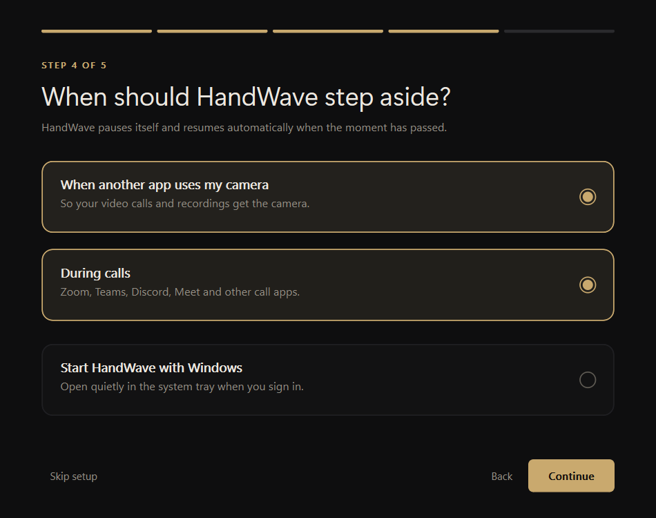
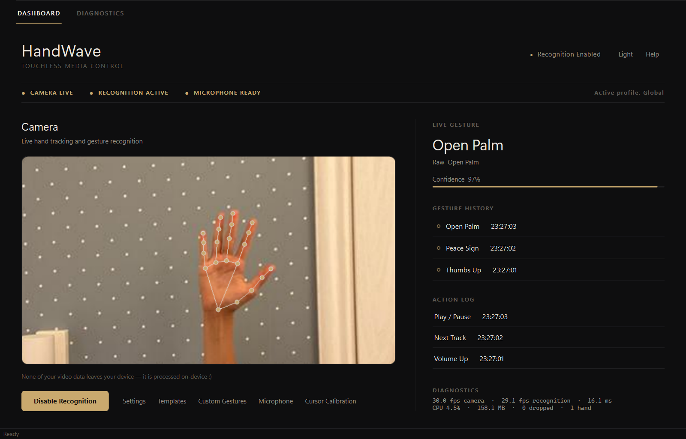
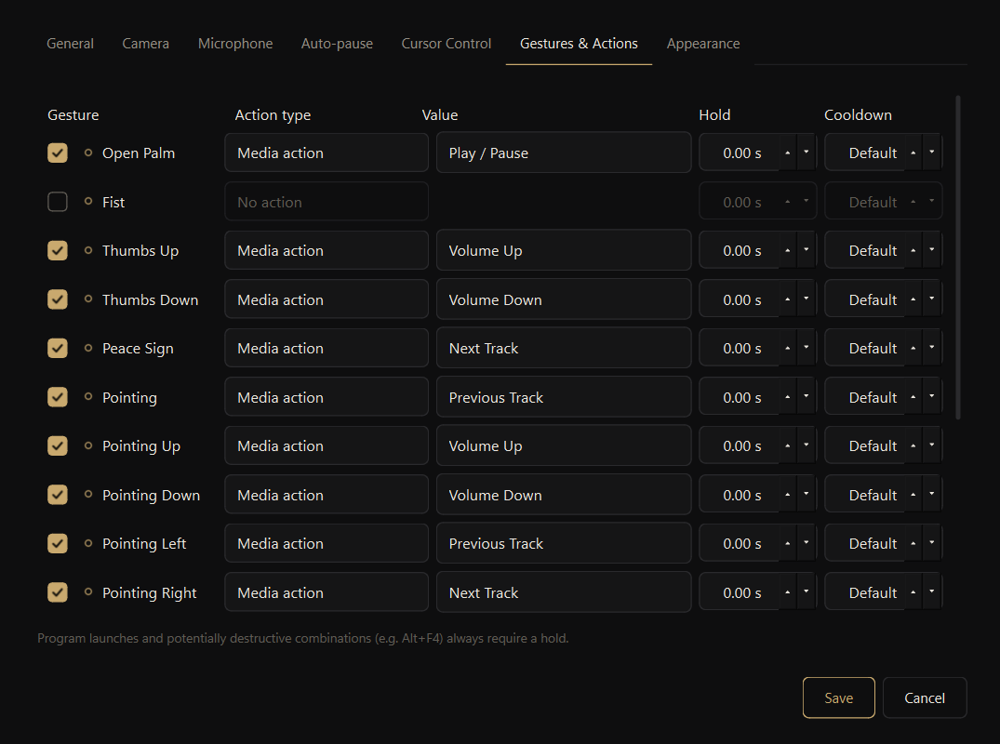
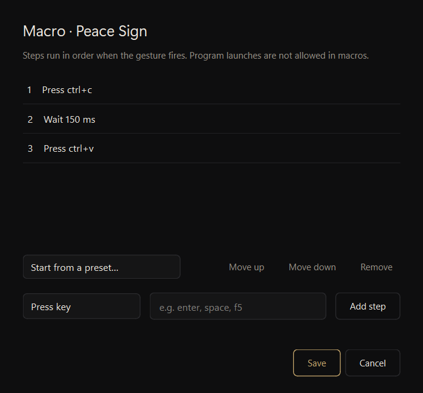
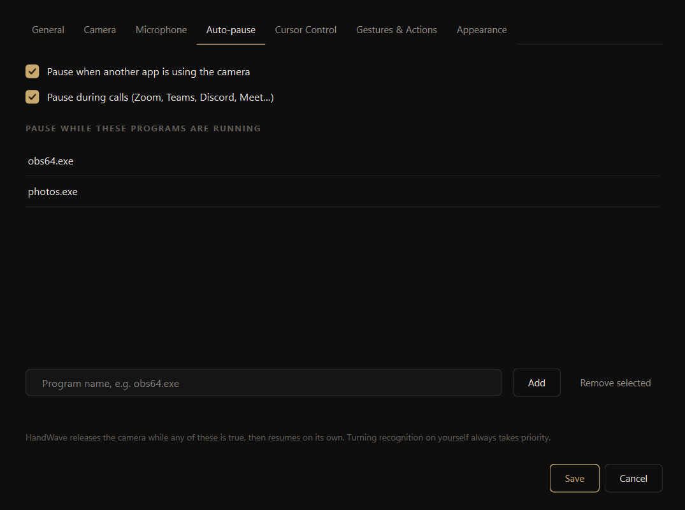
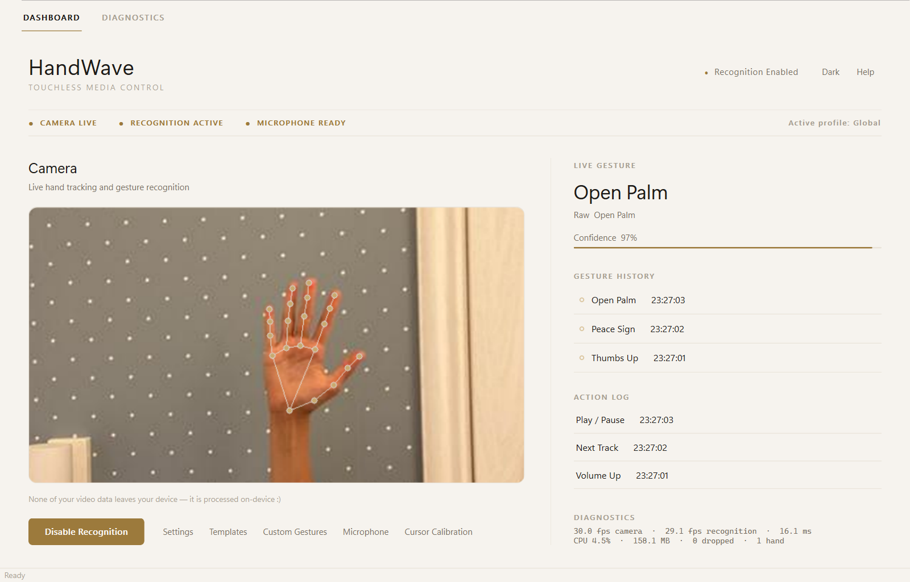
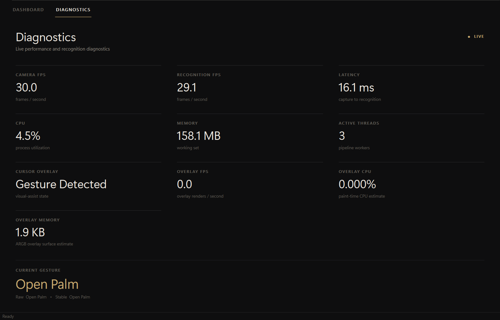

# User guide

> On a Mac? Read [macos.md](macos.md) first; macOS support is experimental.

## Getting started

Download `HandWave.exe` from the [releases page](https://github.com/IshitaBhatt486/HandWave/releases)
and run it, or use the installer if you want Start Menu shortcuts. The first
time it opens, a short setup asks what your gestures should control, which
camera to use, whether to use double-clap, when HandWave should pause itself,
and which theme you like. You can skip it and keep the defaults, and rerun it
later from the tray menu (**Run setup again…**).

Source: screenshot of HandWave 1.1.0.

Windows will ask for camera access, and for the microphone if you turn on
double-clap.

## The dashboard

Source: screenshot of HandWave 1.1.0. Hand photo from [HaGRID](https://github.com/hukenovs/hagrid) (Kapitanov et al.), [HaGRID licence](https://github.com/hukenovs/hagrid/blob/master/license/en_us.pdf), cropped, run through HandWave's recogniser; not MIT-licensed. See [NOTICE](demo/NOTICE.md).

The camera preview sits in the middle with your hand's landmarks drawn on it.
Around it you'll see the current gesture and its confidence, the recent
gesture history, an action log, and a status strip for the camera,
recognition and microphone.

**Enable Recognition** turns the camera on and **Pause** releases it. The
camera starts automatically when HandWave opens unless you turn that off in
**Settings → General**. Closing the window sends HandWave to the system tray;
double-click the tray icon to bring it back, or choose **Exit** from the tray
menu to quit.

## Making gestures

Keep your hand roughly in the middle of the frame with the wrist visible.
Hold a pose for about half a second; it fires once, and you need to change
pose before it fires again.

| Gesture | How |
|---|---|
| Open palm | All five fingers straight, palm to the camera |
| Fist | All fingers folded |
| Thumbs up / down | Fingers folded, thumb clearly up or down |
| Peace sign | Index and middle finger up, others folded |
| Pointing | Only the index finger out; up, down, left and right can each have their own action |
| Swipe | Move your whole hand sideways in one quick motion |
| Finger / hand swipe up or down | The same, vertically, with one finger or an open hand |
| Pinch volume | Touch thumb and index tips, then move up or down |
| Two hands | Both palms open or both fists; or move open hands apart or together |

## Changing what gestures do

Open **Settings** from the dashboard or the tray menu. In **Gestures &
Actions** you can turn each gesture on or off and give it a media key, a key,
a shortcut, a mouse action, some text to type, a program to launch, or a
macro. Program launches always need you to hold the pose a little longer, so
they don't fire by accident. Changes apply as soon as you save.

Source: screenshot of HandWave 1.1.0.

**Sensitivity** and **Cooldown** in **Settings → General** apply to all
gestures. Higher sensitivity needs a more confident hand detection.

Your settings live in `%APPDATA%\HandWave\config\settings.json`.

### Macros

Set a gesture's action type to **Macro (sequence)** and choose **Add steps…**.
A macro can press keys and shortcuts, use media and mouse actions, type text
and wait between steps (up to 32 steps and 10 seconds of waiting in total).
Start from a preset such as *Copy, then paste*, or build your own. Macros
can't launch programs.

Source: screenshot of HandWave 1.1.0.

### Custom gestures

Record a pose a few times and HandWave learns it alongside the built-in ones.
Only features derived from the hand landmarks are saved, never images. Custom
gestures are single-hand static poses.

### Templates

**Templates** on the dashboard saves your whole gesture setup under a name, so
you can switch between, say, a media setup and a presentation setup. Templates
can be exported and imported as files.

Per-app profiles that switch with the focused window are built and tested, but
don't have an editor yet; see [profiles.md](profiles.md).

## Double-clap

Clap twice, between 0.12 and 1 second apart, to turn recognition on or off.
HandWave only measures loudness; audio is never recorded or saved.

To tune it for your room, click **Microphone** on the dashboard and then
**Recalibrate**: stay quiet for 3 seconds, clap 5 times, then double-clap to
confirm. More options (input device, minimum loudness, timing) are in
**Settings → Microphone**.

## Auto-pause

In **Settings → Auto-pause**, HandWave can step aside:

- **while another app uses the camera** (Windows' own camera-usage records),
- **during calls** in Zoom, Teams, Discord, Skype, Slack, Webex, WhatsApp, or
  a browser using the microphone,
- **while programs you choose are running**, for example `obs64.exe`.

It checks every few seconds, shows why it paused, and resumes when the reason
is gone. If you switch recognition on yourself while it's paused, HandWave
respects that until a new reason comes up.

Source: screenshot of HandWave 1.1.0.

## Cursor calibration

**Cursor Calibration** learns how far you comfortably move your hand. Hold
your index finger in the centre, then reach left, right, up and down, then
steer the on-screen cursor onto five targets. Afterwards a cursor overlay
follows your hand. It's visual only and doesn't move the real mouse pointer.
Turn it off in **Settings → Cursor Control**.

## Appearance and performance

- Switch between dark and light mode from the title bar.
- **Settings → Appearance → Reduce motion** turns off animations.
- **Settings → Camera → Faster hand model** roughly halves tracking time on
  older laptops at a small cost in accuracy.

Source: screenshot of HandWave 1.1.0. Hand photo from [HaGRID](https://github.com/hukenovs/hagrid) (Kapitanov et al.), [HaGRID licence](https://github.com/hukenovs/hagrid/blob/master/license/en_us.pdf), cropped, run through HandWave's recogniser; not MIT-licensed. See [NOTICE](demo/NOTICE.md).

## Diagnostics

Source: screenshot of HandWave 1.1.0 measuring its own recognition of a HaGRID photo.

The **Diagnostics** tab shows camera and recognition FPS, latency, CPU,
memory and dropped frames. Some dropped frames are normal: when the camera is
faster than recognition, HandWave skips old frames so it always reacts to
where your hand is now.

## Starting with Windows

Turn on **Launch at Windows Startup** in the tray menu.

## Uninstalling

If you used the installer, remove HandWave from **Settings → Apps →
Installed apps**. For the portable exe, just delete it. Either way, your
settings stay in `%APPDATA%\HandWave`; delete that folder to remove them too.

Having trouble? See [troubleshooting.md](troubleshooting.md).
