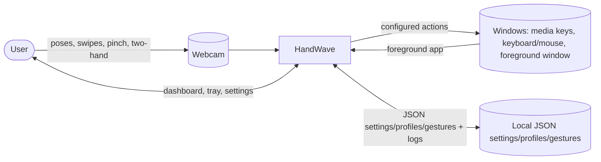
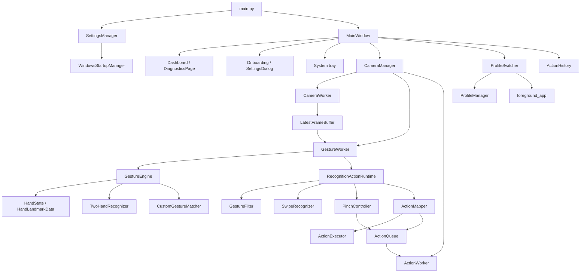
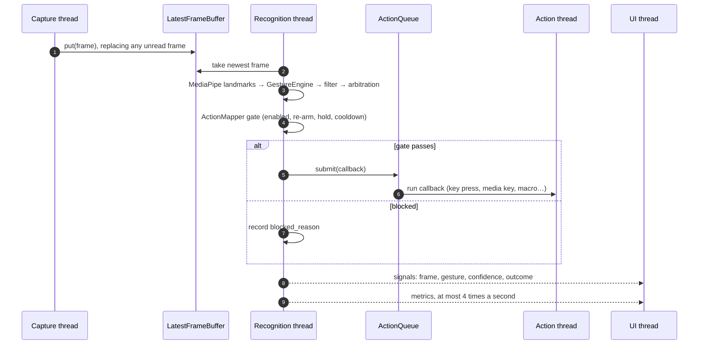
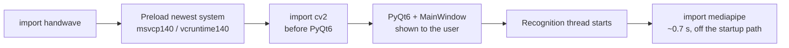
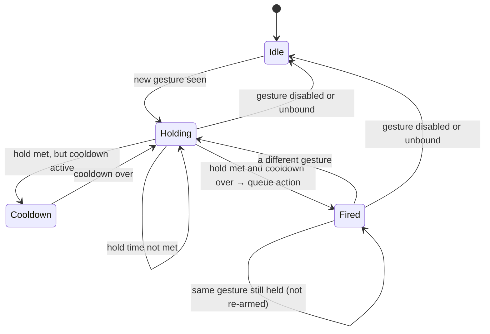
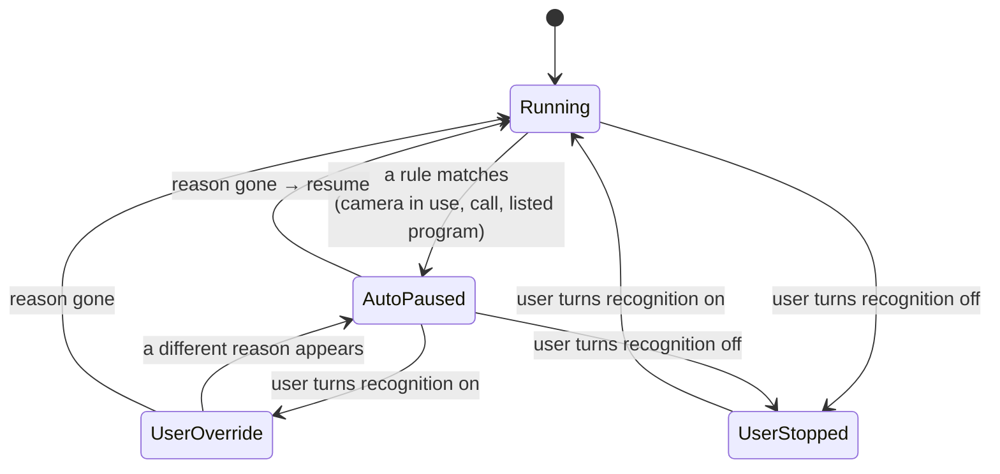
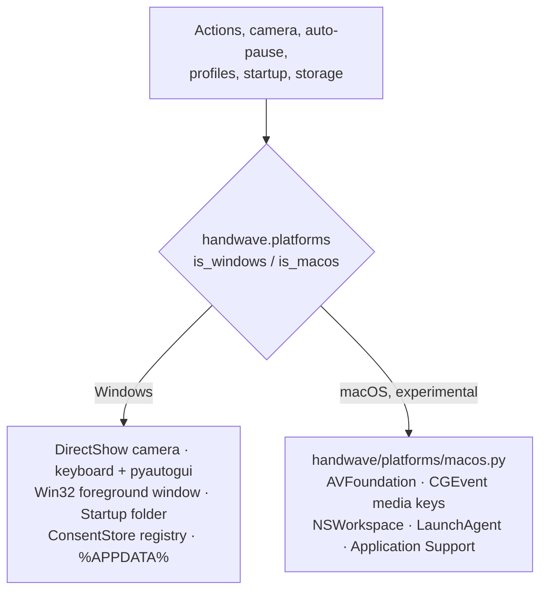
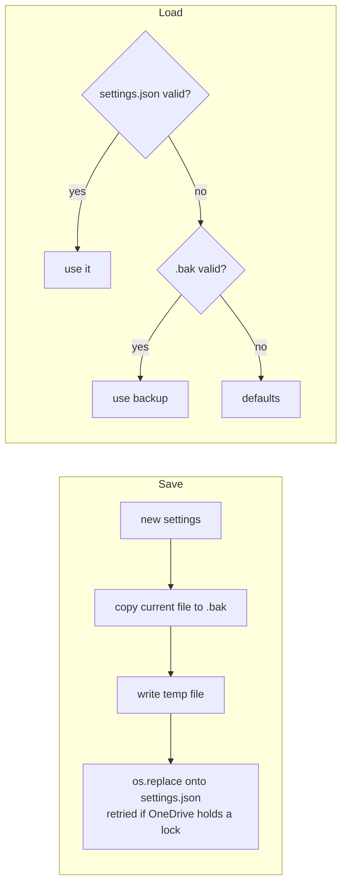

# Architecture

## Design goals

HandWave prioritizes fresh input over processing every frame, keeps blocking
work off the UI thread, confines mutable recognition state to one worker
thread, and isolates OS side effects behind an action queue. The camera
backend, input simulation, startup, foreground-app detection and packaging are
platform-specific (Windows, with experimental macOS code in
`handwave/platforms/macos.py`). Everything runs locally: there is no network
service, account or database.

## System context

## Component architecture

## Threads and why

| Thread | Owns | Never blocks on |
|---|---|---|
| UI (Qt main) | `MainWindow`, dialogs, tray | camera I/O, MediaPipe, OS action calls |
| Capture | `CameraWorker` — `cv2.VideoCapture` | recognition or action execution |
| Recognition | `GestureWorker` — MediaPipe, `GestureEngine`, filters, `ActionMapper.execute()` | OS action calls (queued instead) |
| Action | `ActionWorker` draining `ActionQueue` | camera or recognition |

`LatestFrameBuffer` (capacity one) sits between capture and recognition: when
recognition can't keep up, the capture thread's *newest* frame replaces the
unprocessed one instead of queuing — see [benchmarking.md](benchmarking.md)
for the measured effect. `ActionMapper.execute()` never calls the OS directly;
it hands a callback to `ActionQueue`, so a slow keyboard/mouse/program-launch
call can never stall recognition (see [actions.md](actions.md)).

## Data flow per frame

1. `CameraWorker` reads a frame, pushes it into `LatestFrameBuffer`.
2. `GestureWorker` pulls the latest frame, runs MediaPipe (up to 2 hands),
   builds one `HandState` per detected hand.
3. `GestureEngine.recognize_hands()` — the single recognition entry point used
   both live and by `scripts/replay_gesture.py` — runs built-in pattern
   matching, an optional custom-gesture matcher, and `TwoHandRecognizer`.
4. `RecognitionActionRuntime` filters, evaluates pinch and swipe motion, and
   uses the gesture arbitration policy to choose one action name: **two-hand
   gesture > pinch > swipe > static gesture** (see
   [gesture-recognition.md](gesture-recognition.md)).
5. `ActionMapper.execute()` applies cooldown/re-arm/hold-duration rules and
   either runs the bound `ActionDefinition` (via the queue) or records why it
   didn't (`ActionOutcome.blocked_reason`).
6. `MainWindow` logs the outcome into a bounded `ActionHistory` and updates
   the dashboard/diagnostics.

The same steps as a sequence, showing which thread does what:

## Startup order

Native libraries have to load in a fixed order on Windows, or the app can
crash intermittently. `handwave/__init__.py` runs `prepare_native_libraries()`
before anything else is imported:

## Action gate

`ActionMapper.execute()` runs on every recognised frame. A pose fires once
and has to be released before it can fire again:

Disabled gestures, unbound gestures and failures are recorded as
`blocked_reason`, which is what the dashboard's action log shows.

## Auto-pause

`AutoPauseMonitor` checks its rules on a background thread every few seconds
and only publishes a change of reason. What the user does by hand always wins:

Camera and microphone use come from Windows' privacy records (the data behind
the taskbar camera icon), and running programs from a process snapshot.
HandWave's own process is ignored.

## Platform layer

Everything OS-specific is chosen at call time, so the rest of the code (and
the tests) can treat Windows and macOS the same way:

PyObjC is only imported inside the macOS functions, so Windows never loads it.

## Application profiles

`ProfileManager` (`handwave/config/profile_manager.py`) persists named
`Profile` objects that override a *sparse* subset of global settings
(sensitivity, cooldown, gesture bindings) — unset fields inherit the global
value at `Profile.resolve()` time, so profiles never copy the whole
configuration. `ProfileSwitcher` polls the foreground application
(`handwave/services/foreground_app.py`, Win32 `ctypes`) and matches it against
profiles deterministically (disabled profiles excluded; exact executable +
window-title match beats executable-only; no match falls back to explicit
selection, then Global). Applying a switch only swaps `ActionMapper`'s
bindings/cooldown in place — the camera thread and MediaPipe instance are
never recreated. See [profiles.md](profiles.md).

## Persistence

Settings, profiles, templates and custom gestures are JSON files in the
per-user config folder (`%APPDATA%\HandWave\config` on Windows,
`~/Library/Application Support/HandWave/config` on macOS). Files left inside
the source tree by older versions are copied there once
(`handwave/config/storage.py`). `SettingsManager`, `ProfileManager`,
`TemplateManager` and `CustomGestureStore` all follow the same pattern: a `schema_version` field, atomic `temp-file + os.replace` writes
(via `handwave/config/atomic_write.py`, which retries past the transient
`PermissionError` a cloud-sync client like OneDrive can cause), a `.bak` copy
written before every overwrite, and recovery from that backup if the primary
file is corrupted JSON.

## Known limitations

- Two-hand tracking assumes MediaPipe's hand identity stays stable across a
  frame; hands crossing rapidly can occasionally swap which `HandState` is
  "primary" — not a crash, just a possible one-frame pose flicker.
- `ProfileSwitcher`'s foreground-app lookup can fail (return unknown) for
  elevated/protected processes; it falls back to Global rather than guessing.
- Custom gestures are static, single-hand poses only.
- The cursor reach overlay is visual feedback only; it never moves the OS
  cursor. Fingertip x is mirrored (`MainWindow._mirror_fingertips`) so reach
  is expressed from the user's point of view on unmirrored webcam frames.
