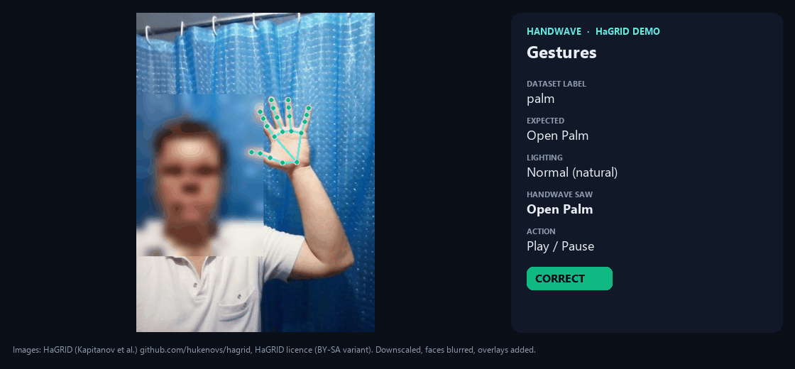
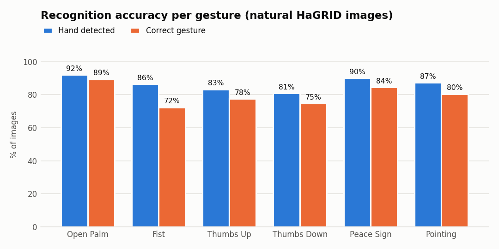
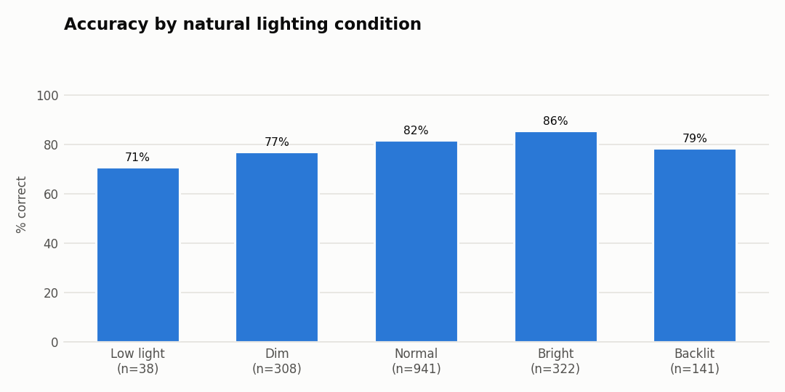
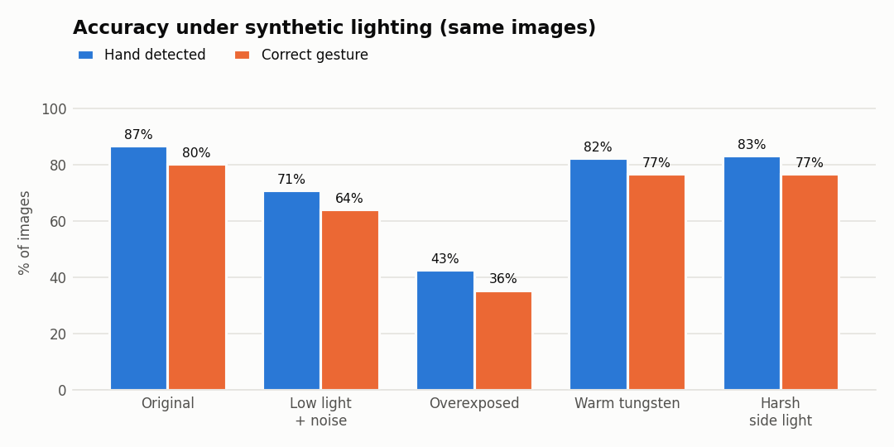
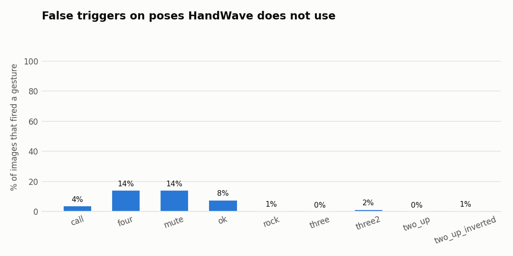

# HandWave on HaGRID: accuracy, lighting robustness and latency

*Run on 2026-11-08 · 2,875 annotated hands · 5,115 recognitions · HandWave `GestureEngine` + MediaPipe 0.10.14*



<sub>Source: animation made by `benchmarks/make_hagrid_demo.py` from [HaGRID](https://github.com/hukenovs/hagrid) (Kapitanov et al.), [HaGRID licence](https://github.com/hukenovs/hagrid/blob/master/license/en_us.pdf); faces blurred, overlays added. See [docs/demo/NOTICE.md](../demo/NOTICE.md). An MP4 version is at [docs/demo/hagrid-demo.mp4](../demo/hagrid-demo.mp4).</sub>

## Update: recommendations 1–4 implemented

The thumb, Peace Sign, Pointing and Thumbs Down fixes below were made and
tuned on cached HaGRID landmarks, then re-measured end to end with the full model:

| | Original rules | Improved rules |
|---|---|---|
| Gesture accuracy (1,750 images) | 58.8% | **81.2%** |
| Accuracy when a hand is found | 67.3% | **92.9%** |
| False triggers (1,125 images) | 13.3% | **4.9%** |
| Peace Sign / Pointing / Thumbs Up / Thumbs Down | 6% / 42% / 55% / 59% | 84% / 80% / 78% / 75% |
| `four` → Open Palm / `two_up` → Peace | 61% / 23% | 14% / 0% |

The charts and [hagrid-results.md](hagrid-results.md) now show the improved
rules. **Sections 3 and 4 below describe the original baseline** and explain
what was fixed. Overexposure (recommendation 5) remains the weakest condition
(36% on overexposed images). See also [../performance.md](../performance.md).

## Summary (original baseline)

| | Result |
|---|---|
| Open Palm, Fist | **87% and 77%** correct. Reliable. |
| Thumbs Up, Thumbs Down | **55% and 59%** correct. |
| Pointing | **42%** correct; when recognized, the direction was always right (100% "Up"). |
| Peace Sign | **6%** correct. Effectively broken on real-world poses. |
| Overall (6 gestures, 1,750 images) | **58.8%** correct; a hand was found in 87.4% of images. |
| False triggers on 9 other poses | **13.3%** overall, driven by `four` → Open Palm (61%) and `two_up` → Peace Sign (23%). |
| Lighting | Accuracy falls from 63% (bright) to 45% (low light). Overexposure is the worst condition: 26% vs 58% on the same images. |
| Latency | **~50 ms** per frame when cool (≈20 FPS), rising to **~100 ms** under sustained load on this laptop. |

**The biggest problem is one rule, not the hand tracker.** MediaPipe found
the hand in 80–92% of images for every gesture. The losses come from
HandWave's thumb test. In 60 of 60 sampled Peace Sign failures and 60 of 60
Pointing failures, the app decided the tucked thumb was *extended*. In 52 of
52 Thumbs Up → Fist errors it decided the raised thumb was *folded*. Fixing
the thumb test is the single change with the most upside
([recommendations](#recommendations)).

## 1. Dataset choice and licence check

You asked to check, before using any clips, whether Jester or HaGRID may be
used in an open-source app.

| | **HaGRID** (chosen) | **Jester** (20BN, now Qualcomm) |
|---|---|---|
| Content | Still images of 33+ static hand poses, ~1.5 TB full / 716 GB v1 | 148k short videos of 27 dynamic gestures |
| Licence | Custom "Public license with attribution and conditions reserved", a reworking of CC BY-SA 4.0 ([PDF](https://github.com/hukenovs/hagrid/blob/master/license/en_us.pdf)) | Distributed under a licence agreement you must accept with Qualcomm. Secondary sources describe it as **non-commercial** (CC BY-NC-ND or BY-NC-SA, depending on the source); I could not retrieve the official text. |
| Benchmark use | ✅ Allowed | ⚠️ Likely allowed only for non-commercial research, after signing |
| Publish frames/clips in a public repo | ✅ Allowed with attribution, change notice, link to the licence, and the **same licence** on the adapted files | ❌ Not safe: no-derivatives and/or non-commercial terms conflict with an MIT project anyone may use commercially |
| Download without an account | ✅ | ❌ Requires sign-in and acceptance |

**What the HaGRID licence requires, and how this repo complies:**

- *Attribution, change notice and licence link* (Section 3a): in every demo
  frame's footer, in [docs/demo/NOTICE.md](../demo/NOTICE.md), and in this
  report.
- *Share-alike for adapted material* (Section 3b): the demo GIF, MP4 and
  frames are adapted images, so they are under the HaGRID licence, **not** MIT.
  NOTICE.md says so. The code that produces them stays MIT.
- *No endorsement implied* (Section 2a6): stated in NOTICE.md.
- *Personal rights are not licensed* (Section 2b1): the licence cannot grant
  the publicity or privacy rights of the people pictured. Faces in the demo
  are therefore blurred automatically (MediaPipe face detection, wide margin),
  and all 18 frames were checked by eye. NOTICE.md offers takedown on request.

**What is *not* in the repo:** dataset images. The benchmark reads them from a
local folder you download yourself. Results contain only image IDs, labels and
scores.

Jester would be the natural fit for **swipe** gestures, which HaGRID's still
images cannot test. If you want that later, use it locally for private
evaluation only, after accepting Qualcomm's terms, and publish numbers but no
frames.

## 2. Method

- **Data:** [`cj-mills/hagrid-sample-30k-384p`](https://huggingface.co/datasets/cj-mills/hagrid-sample-30k-384p),
  a 1 GB, 31,833-image HaGRID sample downscaled to 384 px tall (683×384).
  250 random images per positive class, 125 per negative class (seed 7).
- **Ground truth mapping:**

  | HaGRID class | HandWave gesture | Default action |
  |---|---|---|
  | `palm`, `stop` | Open Palm | Play / Pause |
  | `fist` | Fist | none (disabled by default) |
  | `like` | Thumbs Up | Volume Up |
  | `dislike` | Thumbs Down | Volume Down |
  | `peace` | Peace Sign | Next Track |
  | `one` | Pointing (expected direction: Up) | Volume Up |

  **Negatives:** `call`, `four`, `mute`, `ok`, `rock`, `three`, `three2`,
  `two_up` and `two_up_inverted`. HandWave has no gesture for these, so any
  gesture it outputs would fire an unintended action.
- **Engine:** the app's own `GestureEngine` and pose rules at the default
  sensitivity of 0.6. MediaPipe runs in *still-image mode*: the app normally
  tracks across video frames, and tracking state would leak between unrelated
  photos. Still-image mode equals the first frame of a live session.
- **Hand matching:** the detected hand whose landmark centroid falls inside
  the annotated gesture box (±25%) is scored, so the person's other, resting
  hand never counts. If none matches, the result is *Not detected*.
- **Natural lighting:** each image is bucketed by the mean luma (0–255) of the
  gesture box: Low light < 80, Dim < 120, Normal < 170, Bright ≥ 170.
  *Backlit* means the scene is ≥ 35 luma brighter than the hand. HaGRID has
  no lighting labels, so these thresholds are this report's own heuristic.
- **Synthetic lighting:** 80 images per positive class (560 total) were rerun
  with four photometric changes that leave the pose untouched: *Low light +
  noise* (gamma 1.6, ×0.35, σ=4 sensor noise), *Overexposed* (×1.7 + 35),
  *Warm tungsten* (blue ×0.55, overall ×0.85) and *Harsh side light* (a
  0.25→1.35 left-to-right gradient). Each condition is compared with the same
  images unmodified, so the differences are caused by lighting alone.
- **Machine:** Intel Core (Family 6 Model 154, i.e. 12th-gen mobile), Windows,
  Python 3.11.9, CPU only.

Generated tables with every number are in
[hagrid-results.md](hagrid-results.md); raw per-image results are in
[`benchmarks/results/hagrid/`](../../benchmarks/results/hagrid/).

## 3. Results

### Per gesture


<sub>Source: chart generated by `benchmarks/benchmark_hagrid.py` from HandWave's results on HaGRID. It contains no HaGRID images.</sub>

| Gesture | Images | Hand found | Correct | Correct when found | Main error |
|---|---|---|---|---|---|
| Open Palm | 500 | 92.0% | **86.6%** | 94.1% | missed detection (40) |
| Fist | 250 | 86.4% | **77.2%** | 89.4% | → Thumbs Up (21) |
| Thumbs Up | 250 | 83.2% | **54.8%** | 65.9% | → Fist (52) |
| Thumbs Down | 250 | 80.8% | **58.8%** | 72.8% | → No gesture (39) |
| Peace Sign | 250 | 90.0% | **5.6%** | 6.2% | → No gesture (211) |
| Pointing | 250 | 87.2% | **42.0%** | 48.2% | → No gesture (111) |

`palm` (fingers spread) scores 90% and `stop` (fingers together) 83%, so
both forms of an open palm work.

### Natural lighting


<sub>Source: chart generated by `benchmarks/benchmark_hagrid.py` from HandWave's results on HaGRID. It contains no HaGRID images.</sub>

| Condition | Images | Hand found | Correct |
|---|---|---|---|
| Low light | 38 | 76.3% | 44.7% |
| Dim | 308 | 85.1% | 53.2% |
| Normal | 941 | 88.1% | 59.4% |
| Bright | 322 | 90.1% | 62.7% |
| Backlit | 141 | 84.4% | 61.7% |

Accuracy rises with light. Backlighting hurts detection a little but not
classification. The low-light bucket is small (38 images), so treat its exact
value as indicative only: plus or minus about 16 percentage points at 95%
confidence.

### Synthetic lighting (same 560 images)


<sub>Source: chart generated by `benchmarks/benchmark_hagrid.py` from HandWave's results on HaGRID. It contains no HaGRID images.</sub>

| Condition | Hand found | Correct | Change vs original |
|---|---|---|---|
| Original | 86.8% | 58.0% | — |
| Warm tungsten | 82.5% | 53.4% | −4.6 pts |
| Harsh side light | 83.2% | 53.6% | −4.4 pts |
| Low light + noise | 70.9% | 45.0% | −13.0 pts |
| **Overexposed** | **42.9%** | **26.1%** | **−31.9 pts** |

Colour casts and uneven light cost about 5 points. Dim, noisy video costs 13.
**Blown-out highlights halve hand detection.** A webcam pointed at a bright
window, or one with aggressive auto-exposure, is the riskiest real-world setup.

### False triggers


<sub>Source: chart generated by `benchmarks/benchmark_hagrid.py` from HandWave's results on HaGRID. It contains no HaGRID images.</sub>

Out of 1,125 images of other poses, 13.3% fired a HandWave gesture. Nearly all
of that comes from two look-alikes:

- `four` (four fingers up, thumb tucked) → **Open Palm in 61%**, which would
  toggle play/pause. This is the same thumb problem in reverse: a tucked thumb
  counted as extended.
- `two_up` (index and middle together) → **Peace Sign in 23%**. HandWave does
  not check that the two fingers are spread.

Every other pose triggered something in under 9% of images.

### Latency

| Measurement | p50 | p95 |
|---|---|---|
| Still-image mode, cool machine (40 images) | 47.0 ms | 71.9 ms |
| Live tracking mode, held pose (400 frames) | 50.1 ms | 70.0 ms |
| Full benchmark run, first 1,000 calls | 50.7 ms | 125.0 ms |
| Full benchmark run, calls 3,000–4,000 | 101.1 ms | 178.7 ms |

`GestureEngine.process` costs about **50 ms** per frame on this CPU, a ceiling
of about 20 recognized frames per second. Tracking mode was not faster: this
MediaPipe build runs the landmark model every frame either way. Under
sustained load the per-frame time **doubled** within a few minutes, most
likely from laptop thermal or power throttling (not proven). The app's
latest-frame buffer keeps this from building up a backlog, but gestures are
sampled less often on a hot laptop.

## 4. Root cause of the accuracy gap

Finger states of the matched hand for misclassified images (60 sampled per
row; `E` = extended, `f` = folded):

| HaGRID pose → wrong result | Thumb | Index | Middle | Ring | Pinky | Share |
|---|---|---|---|---|---|---|
| `peace` → No gesture | **E** | E | E | f | f | 60/60 |
| `one` → No gesture | **E** | E | f | f | f | 60/60 |
| `like` → Fist | **f** | f | f | f | f | 52/52 |
| `dislike` → No gesture | E | f | f | f | f | 37/39 |

- **Peace / Pointing / four:** HaGRID's poses hold the thumb across the palm.
  HandWave's thumb test reports that as extended, so the pattern (which
  requires a folded thumb) never matches, and `four` looks like an open palm.
- **Thumbs Up:** the opposite failure. A raised thumb seen side-on is judged
  folded, so the hand looks like a fist.
- **Thumbs Down:** the finger states are right, but `_thumb_points_down`
  requires the thumb to be more vertical than horizontal, which rejects
  slanted thumbs.

## Recommendations

In order of expected impact:

1. **Rewrite the thumb-extension test** (`HandLandmarkData.get_finger_states`).
   Judge the thumb by the distance of its tip from the index MCP (landmark 5)
   and the palm centre, relative to hand size, rather than a single-axis
   comparison. This one change targets about 21% of all positive images
   (374 of 1,750: Peace, Pointing, Thumbs Up) and most of the `four` false triggers.
2. **Make Peace Sign and Pointing ignore the thumb.** Neither gesture needs
   the thumb to be folded to be unambiguous. Treat it as "don't care" in
   `GESTURE_PATTERNS`.
3. **Require a spread for Peace Sign**: an angle between the index and middle
   finger rays of more than about 15°. This rejects `two_up` (23% false
   triggers).
4. **Loosen the Thumbs Down direction check** to accept a thumb pointing within
   about 45° of straight down.
5. **Handle overexposure**: detect a blown-out frame (high share of pixels
   at luma ≥ 250) and show "Too bright — move away from the window" in the
   status strip, instead of failing silently.
6. **Re-run this benchmark after each change.** `python -m benchmarks.benchmark_hagrid`
   is deterministic for a given seed, so the before/after numbers are directly
   comparable.

## 5. Limitations

- **Still images only.** Swipes, pinch-volume and two-hand gestures are not
  covered. A dynamic dataset would be needed for those (see the Jester note
  in section 1).
- **Distance and resolution.** HaGRID subjects stand 0.5–4 m away and the sample
  is downscaled to 384 px, so hands are small. A typical desk webcam at
  640×480 and 50–80 cm shows a much larger hand, so detection rates here are
  probably pessimistic.
- **No temporal smoothing.** The live app adds a stability filter, hold times
  and cooldowns. One wrong frame here might never fire an action in practice,
  and the false-trigger numbers are per frame, not per action.
- **Lighting buckets are heuristic.** They are derived from pixel brightness,
  not from labels.
- **One machine, CPU only.**

## 6. Reproduce

```powershell
# 1. Download the sample (1 GB) outside the repo / OneDrive
$d = "$env:LOCALAPPDATA\HandWave\datasets\hagrid-sample-30k-384p"
New-Item -ItemType Directory -Force $d | Out-Null
curl.exe -L -o "$d\hagrid-sample-30k-384p.zip" https://huggingface.co/datasets/cj-mills/hagrid-sample-30k-384p/resolve/main/hagrid-sample-30k-384p.zip
Expand-Archive "$d\hagrid-sample-30k-384p.zip" $d

# 2. Benchmark (~9 min on a laptop CPU) and demo
.venv\Scripts\python.exe -m benchmarks.benchmark_hagrid --data-dir $d
.venv\Scripts\python.exe -m benchmarks.make_hagrid_demo --data-dir $d

# Rebuild charts/tables from saved results without re-running
.venv\Scripts\python.exe -m benchmarks.benchmark_hagrid --report-only
```

---

HaGRID: A. Kapitanov, K. Kvanchiani, A. Nagaev, R. Kraynov, A. Makhliarchuk,
*HaGRID — HAnd Gesture Recognition Image Dataset*, WACV 2024.
<https://github.com/hukenovs/hagrid>. Used under the HaGRID licence; HaGRID's
authors do not endorse HandWave.
