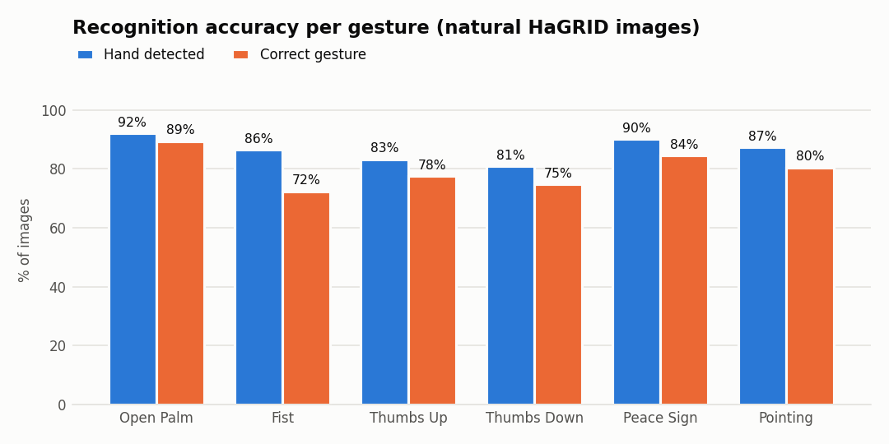
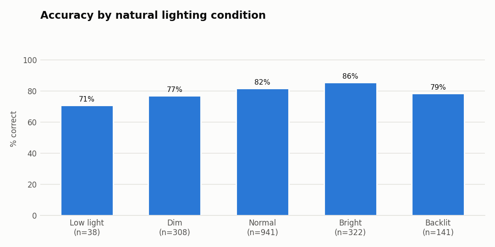
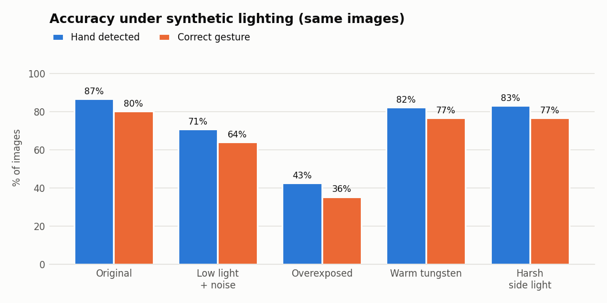
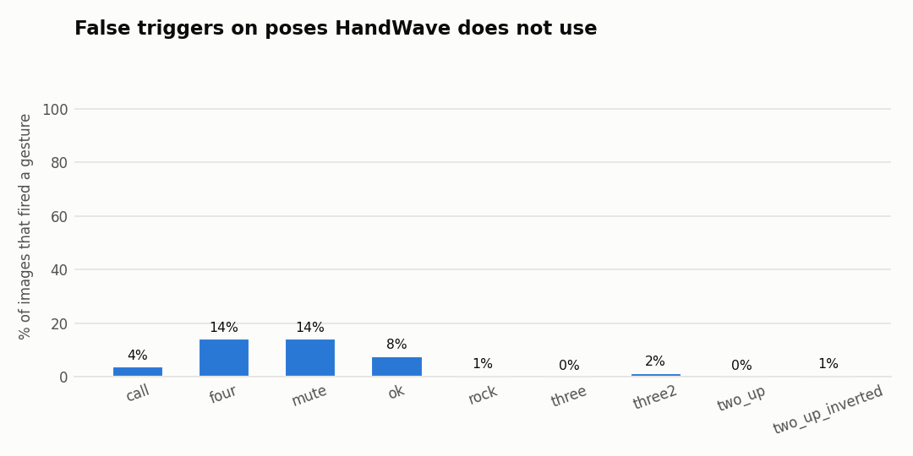

# HaGRID benchmark — generated results

> Generated by `python -m benchmarks.benchmark_hagrid`. Do not edit by hand;
> see [HAGRID_BENCHMARK_REPORT.md](HAGRID_BENCHMARK_REPORT.md) for the analysis.

- Dataset: HaGRID sample 30k (384p) (2875 annotated hands, seed 7)
- Engine: HandWave `GestureEngine`, MediaPipe Hands still-image mode, sensitivity 0.6
- Machine: Intel64 Family 6 Model 154 Stepping 4, GenuineIntel, Windows 10, Python 3.11.9, MediaPipe 0.10.14
- Run: 2026-11-08 20:39

## Headline

| Metric | Value |
|---|---|
| Gesture accuracy (all 6 HandWave poses) | 81.2% of 1750 |
| Hand detection rate | 87.4% |
| Accuracy when a hand was detected | 92.9% |
| False-trigger rate on other poses | 4.9% of 1125 |
| Latency per frame (p50 / p95) | 49.0 ms / 112.8 ms |
| "one" classified as Pointing **Up** | 100.0% |

## Per gesture

| HandWave gesture | Images | Hand detected | Correct | Correct when detected |
|---|---|---|---|---|
| Open Palm | 500 | 92.0% | 89.4% | 97.2% |
| Fist | 250 | 86.4% | 72.4% | 83.8% |
| Thumbs Up | 250 | 83.2% | 77.6% | 93.3% |
| Thumbs Down | 250 | 80.8% | 74.8% | 92.6% |
| Peace Sign | 250 | 90.0% | 84.4% | 93.8% |
| Pointing | 250 | 87.2% | 80.4% | 92.2% |

| HaGRID class | Expected | Images | Correct |
|---|---|---|---|
| `palm` | Open Palm | 250 | 91.6% |
| `stop` | Open Palm | 250 | 87.2% |
| `fist` | Fist | 250 | 72.4% |
| `like` | Thumbs Up | 250 | 77.6% |
| `dislike` | Thumbs Down | 250 | 74.8% |
| `peace` | Peace Sign | 250 | 84.4% |
| `one` | Pointing | 250 | 80.4% |

## Confusion matrix (rows = expected, columns = predicted)

| Expected \ Predicted | Open Palm | Fist | Thumbs Up | Thumbs Down | Peace Sign | Pointing | No gesture | Not detected |
|---|---|---|---|---|---|---|---|---|
| Open Palm | 447 | 0 | 0 | 0 | 0 | 0 | 13 | 40 |
| Fist | 0 | 181 | 35 | 0 | 0 | 0 | 0 | 34 |
| Thumbs Up | 1 | 5 | 194 | 0 | 0 | 0 | 8 | 42 |
| Thumbs Down | 0 | 8 | 1 | 187 | 0 | 0 | 6 | 48 |
| Peace Sign | 0 | 0 | 0 | 0 | 211 | 1 | 13 | 25 |
| Pointing | 0 | 0 | 0 | 0 | 2 | 201 | 15 | 32 |

## Natural lighting

Bucketed by the mean luma (0–255) of the gesture's bounding box; *Backlit* = scene ≥ 35 luma brighter than the hand.

| Condition | Images | Median hand luma | Hand detected | Correct |
|---|---|---|---|---|
| Low light | 38 | 69 | 76.3% | 71.1% |
| Dim | 308 | 107 | 85.1% | 77.3% |
| Normal | 941 | 145 | 88.1% | 81.7% |
| Bright | 322 | 181 | 90.1% | 85.7% |
| Backlit | 141 | 99 | 84.4% | 78.7% |

## Synthetic lighting (paired: identical images, photometric change only)

| Condition | Images | Hand detected | Correct | Open Palm | Fist | Thumbs Up | Thumbs Down | Peace Sign | Pointing |
|---|---|---|---|---|---|---|---|---|---|
| Original | 560 | 86.8% | 80.4% | 89.4% | 73.8% | 73.8% | 71.2% | 81.2% | 83.8% |
| Low light + noise | 560 | 70.9% | 64.1% | 80.6% | 57.5% | 53.8% | 47.5% | 68.8% | 60.0% |
| Overexposed | 560 | 42.9% | 35.5% | 40.6% | 36.2% | 35.0% | 32.5% | 35.0% | 28.8% |
| Warm tungsten | 560 | 82.5% | 77.0% | 86.9% | 67.5% | 65.0% | 71.2% | 83.8% | 77.5% |
| Harsh side light | 560 | 83.2% | 77.0% | 87.5% | 67.5% | 68.8% | 68.8% | 82.5% | 76.2% |

## False triggers (poses HandWave should ignore)

| HaGRID class | Images | Fired a gesture | Fired as |
|---|---|---|---|
| `call` | 125 | 4.0% | Thumbs Up ×5 |
| `four` | 125 | 14.4% | Open Palm ×18 |
| `mute` | 125 | 14.4% | Pointing ×17, Thumbs Up ×1 |
| `ok` | 125 | 8.0% | Open Palm ×10 |
| `rock` | 125 | 0.8% | Pointing ×1 |
| `three` | 125 | 0.0% | — |
| `three2` | 125 | 1.6% | Thumbs Up ×1, Peace Sign ×1 |
| `two_up` | 125 | 0.0% | — |
| `two_up_inverted` | 125 | 0.8% | Peace Sign ×1 |

## Latency

`GestureEngine.process` on 2875 images at the dataset's 384p resolution: mean 59.4 ms, p50 49.0 ms, p95 112.8 ms, max 378.3 ms.

## Charts

Source: charts generated by `benchmarks/benchmark_hagrid.py` from HandWave's results on HaGRID. They contain no HaGRID images.

---

Images: [HaGRID](https://github.com/hukenovs/hagrid) by A. Kapitanov, A. Makhlyarchuk, K. Kvanchiani et al., used under the [HaGRID licence](https://github.com/hukenovs/hagrid/blob/master/license/en_us.pdf); sample via [cj-mills/hagrid-sample-30k-384p](https://huggingface.co/datasets/cj-mills/hagrid-sample-30k-384p) (downscaled). No dataset images are included in this report.
