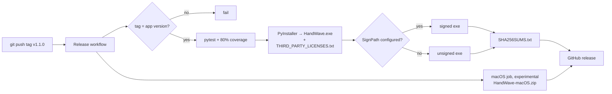

# Building and releasing

## Publishing a release

1. Bump the version in `handwave/version.py`, `packaging/version_info.txt`
   (`filevers`, `prodvers` and the two version strings) and
   `packaging/HandWave.nsi`, and add a `## <version>` section to
   `CHANGELOG.md`. `tests/test_release_config.py` fails if any of these disagree.
2. Run through the manual checks below on a real Windows machine.
3. Tag and push:

   ```powershell
   git tag v1.1.0
   git push origin v1.1.0
   ```



The [release workflow](../.github/workflows/release.yml) runs the tests,
builds `HandWave.exe`, `SHA256SUMS.txt` and `THIRD_PARTY_LICENSES.txt`, signs
the exe if SignPath is set up (see below), and attaches them to a GitHub
release for the tag. It also tries an experimental `HandWave-macOS.zip`; if
that job fails, the Windows release still goes out. Tags with a hyphen
(`v1.2.0-rc.1`) are marked as pre-releases.

The README links to `releases/latest/download/HandWave.exe`, so the "Download"
link always points at the newest non-pre-release. Add a row to the README's
download table for each new version.

## Building locally

```powershell
scripts\setup.cmd dev
winget install --id NSIS.NSIS -e
scripts\build_release.cmd
```

This runs the tests, then writes to `dist\`:

- `HandWave.exe`: the portable app
- `HandWave-<version>-Setup.exe`: the installer
- `SHA256SUMS.txt`

If NSIS is installed somewhere unusual, set `NSIS_MAKENSIS` to the full path
of `makensis.exe`. To build only the exe, run
`python -m PyInstaller --noconfirm packaging\HandWave.spec`.

On macOS, `bash scripts/build_macos.sh` builds an unsigned `dist/HandWave.app`.

## The installer

The installer doesn't need admin rights. It installs to
`%LOCALAPPDATA%\Programs\HandWave`, adds desktop and Start Menu shortcuts, and
registers an uninstaller under **Settings → Apps**. Pass `/S` to the installer
or `Uninstall.exe` for a silent install or uninstall.

Uninstalling keeps `%APPDATA%\HandWave` (settings, profiles, custom gestures),
so a reinstall picks up where you left off. Delete that folder to remove them.

## Manual checks

The test suite can't drive a real camera, so check these with the built exe:

- [ ] Installer shortcuts open HandWave; **Launch at startup** works after a restart.
- [ ] Settings survive an upgrade and an uninstall/reinstall.
- [ ] Every built-in gesture fires its action in bright, normal and dim light,
      and doesn't repeat until you change pose.
- [ ] Swipes left/right switch virtual desktops; pinch changes the volume.
- [ ] Two-hand gestures and a recorded custom gesture work.
- [ ] Unplugging the camera shows an error, and recognition recovers after reconnecting it.
- [ ] Double-clap toggles recognition; talking, typing and single claps don't.
- [ ] Auto-pause triggers when another app opens the camera, and resumes afterwards.
- [ ] Cursor calibration completes and the overlay follows your hand.
- [ ] The fingertip indicator stays aligned at 100%, 150% and 200% display scaling.
- [ ] `SHA256SUMS.txt` matches the files you're publishing.

## Code signing

Releases are unsigned until the SignPath Foundation's free open-source
signing is set up. Once the project is accepted at
[signpath.org](https://signpath.org/), add the secret `SIGNPATH_API_TOKEN`
and the variables `SIGNPATH_ORGANIZATION_ID` and `SIGNPATH_PROJECT_SLUG`
(policy `release-signing`) to the repository. The release workflow then
signs `HandWave.exe` before computing its checksum. Without them, the signing
steps are skipped.
